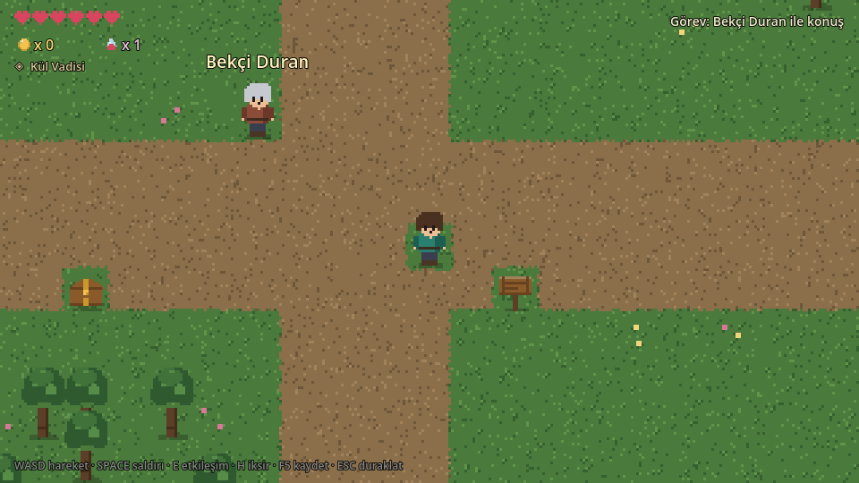
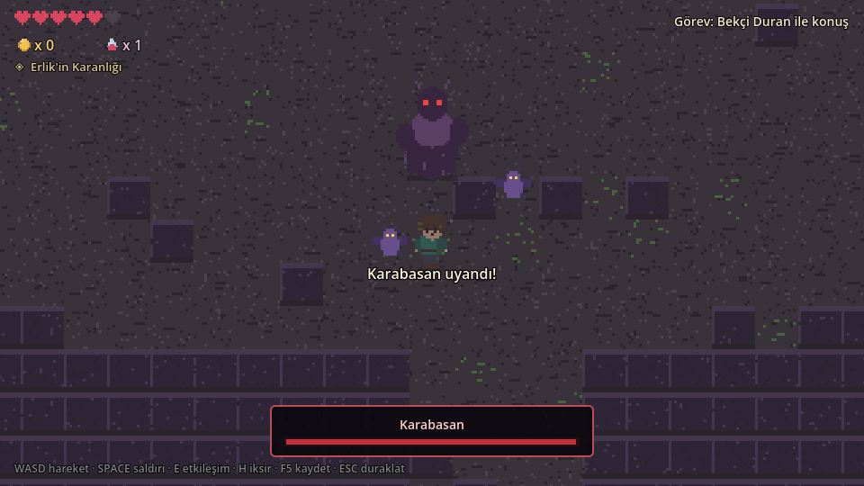
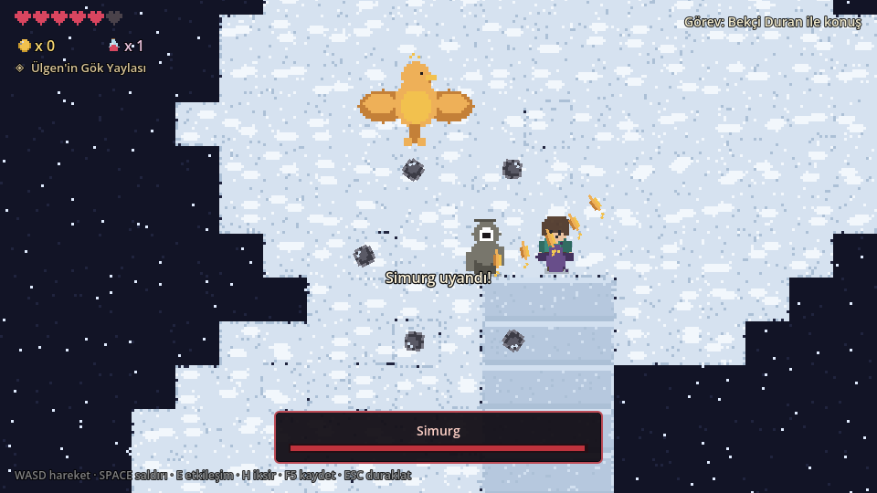
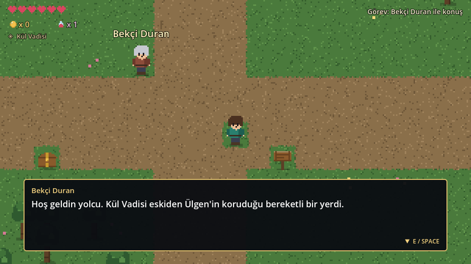

# Kül Vadisi — Üç Boyut

Godot 4.7 ile yapılmış, 2D top-down aksiyon-RPG prototipi.
**Hiçbir ücretli servis, indirilmiş asset veya eklenti yok.** Bütün görseller,
sesler ve haritalar çalışma anında kodla üretilir (`Art.gd`, `Sfx.gd`, `RealmGen.gd`).

## Ekran görüntüleri

| Kül Vadisi | Erlik'in Karanlığı — Karabasan |
|---|---|
|  |  |

| Ülgen'in Gök Yaylası — Simurg | Bekçi Duran ile diyalog |
|---|---|
|  |  |

## Çalıştırma

```bash
git clone https://github.com/aicommands79-debug/kul-vadisi.git
cd kul-vadisi
godot --path .
```

Temiz başlangıç (kayıt dosyasını yok sayar):

```bash
godot --path . -- --fresh
```

## Kontroller

| Tuş | İşlev |
|---|---|
| `WASD` / oklar | hareket |
| `SPACE` / `J` | kılıç saldırısı |
| `E` / `Enter` | konuş, sandık/sunak/kapı kullan |
| `H` | iksir iç (+3 can) |
| `F5` / `F9` | kaydet / yükle |
| `F10` | yeni oyun (kaydı siler) |
| `ESC` | duraklat |

## Hikâye ve ilerleme

1. **Kül Vadisi** — Bekçi Duran ile konuş, 3 balçığı temizle.
2. Ödülü al: **Yer Altı Kapısı** açılır (kuzeydoğu).
3. **Erlik'in Karanlığı** — Karabasan'ı yen. **Kara Kor** kılıcına +5 hasar verir.
4. **Gök Kapısı** açılır (vadi, doğu). **Ülgen'in Gök Yaylası**'na çık.
5. Simurg'u yen. **Simurg'un Tüyü** +2 kalıcı can verir; final ekranı gelir.

Her boyutta bir **Umay Sunağı** vardır: bir kez kullanılır, +2 kalıcı can verir.
Boyutlar arasında geçiş portal ile yapılır; yeni boyuta girişte oyun otomatik kaydedilir.

### Boyutlar

| Boyut | Harita | Tema | Düşmanlar |
|---|---|---|---|
| Kül Vadisi | 64 × 44 karo | köy, orman, gölet, harabe | balçık, kor |
| Erlik'in Karanlığı | 56 × 40 karo | mağara, lav, sütunlar | kor, sürel, tepegöz + Karabasan |
| Ülgen'in Gök Yaylası | 48 × 36 karo | bulut adaları, gök taşı yollar | kor, tepegöz + Simurg |

### Düşmanlar

| Ad | Davranış | Can | Not |
|---|---|---|---|
| Balçık | yavaş takip, temas hasarı | 20 | görev sayacına işler |
| Kor | hızlı, zikzak uçuş | 24 | vadide harabe çevresi |
| Sürel | mesafe korur, taş atar | 46 | yer altı |
| Tepegöz | ağır, çevresine 6 taş saçar | 72 | yer altı + gök |
| **Karabasan** | taş yelpazesi + hücum | 160 | yer altı efendisi |
| **Simurg** | tüy yelpazesi + dalış | 210 | gök efendisi |

## Sistemler

- **Savaş:** yönlü kılıç arkı, vuruş başına `Game.damage` (10 → Kara Kor ile 15),
  düşman knockback + flash + hasar sayısı, 0.9 sn dokunulmazlık, kamera sarsıntısı.
- **Mermiler:** sürel/tepegöz/Karabasan taş atar; Simurg tüy yelpazesi atar.
  Mermiler duvara çarpar, oyuncuya hasar verir.
- **Boss'lar:** uyanma menzili, enrage eşiği (%50 can), farklı saldırı desenleri,
  ekranın altında boss can barı, ödül ve hikâye ilerlemesi.
- **Kayıt:** tek slot `user://save.json`; boyut, konum, hikâye adımı, can, altın,
  iksir, sandıklar, sunaklar ve boss kayıtları saklanır. Eski sürüm kayıtlar reddedilir.
- **HUD:** kalpler, altın, iksir, görev, boyut adı, boss barı, diyalog kutusu,
  bildirimler, duraklatma ve final ekranı.
- **Diyalog:** daktilo efekti, konuşan adı, çok satırlı akış ve callback.
- **Prosedürel ses:** kılıç, vuruş, hasar, ölüm, altın, iksir, diyalog, sandık,
  portal, sunak, taş, tüy, boss ve kükreme sesleri `AudioStreamWAV` olarak sentezlenir.

## Dosya yapısı

```
project.godot            960×540, gl_compatibility, nearest filtre
scenes/Main.tscn         tek sahne; dünyayı kod kurar
scripts/
  Main.gd                boyutu kurar, zemini pişirir, nesneleri/düşmanları doğurur
  RealmGen.gd            üç haritayı deterministik üretir + erişilebilirlik testi
  Game.gd                autoload: durum, hikâye, input, diyalog, kayıt/yükleme
  Sfx.gd                 autoload: prosedürel ses sentezi
  Art.gd                 prosedürel pixel-art: arazi, karakterler, boss'lar, portal
  Player.gd              hareket, saldırı, hasar, iksir
  Enemy.gd               4 düşman tipi (balçık, kor, sürel, tepegöz)
  Boss.gd                Karabasan ve Simurg
  Projectile.gd          taş/tüy mermileri
  Portal.gd              boyut kapıları (kilitli/açık)
  Shrine.gd              Umay Sunağı (+2 can)
  Npc.gd                 Bekçi Duran'ın hikâye diyalogları
  Chest.gd / Sign.gd     sandık ve tabela
  UI.gd                  HUD, diyalog, boss barı, duraklatma, final ekranı
```

## Harita düzenleme

Haritalar `RealmGen.gd` içinde kodla kurulur; elle karakter saymaya gerek yoktur.
Semboller:

| Sembol | Anlam |
|---|---|
| `#` / `~` | katı duvar / su-lav-void |
| `.` `,` `p` | yürünebilir zemin, çiçek, yol |
| `@` | başlangıç noktası |
| `N` `S` | NPC, tabela |
| `C` `X` | sandık |
| `U` | Umay Sunağı |
| `A` `B` | portal (vadide A=yeraltı, B=gök; diğer boyutlarda A=vadi) |
| `1` `2` `3` `4` | balçık, kor, sürel, tepegöz |
| `9` | boss (boyuta göre Karabasan/Simurg) |

Yeni bir boyut için `RealmGen.build()` içine dal ekleyip `_pack()` ile döndürün;
`Game.REALM_NAMES`, portal hedefleri ve `Main._edge_colors()` eşlemelerini güncelleyin.

## Test

```bash
# mantık testleri: erişilebilirlik, düşman, sandık, diyalog, sunak, kayıt, kapılar
godot --headless --path . -- --selftest --fresh

# boss ölümü ve hikâye ödülü (Karabasan)
godot --headless --path . -- --bosstest --fresh --realm=under --tp=30,10

# boss ölümü ve final (Simurg)
godot --headless --path . -- --bosstest --fresh --realm=sky --tp=39,10

# ekran görüntüsü (res://shot.png)
godot --path . -- --shot --fresh
```

Testler mevcut kayıt dosyasını yedekleyip sonunda geri koyar.

### Hızlı görsel kontroller

```bash
# başka boyuta ışınlan
godot --path . -- --shot --fresh --realm=under --tp=30,13
godot --path . -- --shot --fresh --realm=sky --tp=38,11

# diyalog / sunak / portal geçişi / final ekranı
godot --path . -- --shot --fresh --demo-dialog
godot --path . -- --shot --fresh --demo-shrine --tp=28,16
godot --path . -- --shot --fresh --step=2 --demo-portal
godot --path . -- --shot --fresh --demo-ending
```

## Ücretsiz devam yolu

Bu prototip kodla üretilen placeholder görsellerle çalışır. Sanat/ses üretimine
geçerken ücretsiz ve ticari kullanıma açık seçenekler:

- **Görsel:** Krita, Inkscape, Pixelorama · CC0: Kenney.nl, OpenGameArt
- **Ses:** rFXGen/jsfxr (SFX), Audacity, LMMS · CC0: Kenney Audio, Freesound
- **3D (gerekirse):** Blender · CC0: Quaternius, KayKit, Poly Haven
- **Yayın:** itch.io (ücretsiz)

## Lisans

MIT — kod dahil her şey serbestçe kullanılabilir, değiştirilebilir ve paylaşılabilir.
Ayrıntılar `LICENSE` dosyasında. Hiçbir üçüncü taraf asset kullanılmadığı için
lisans çakışması yoktur.

## Bilinen sınırlar

- Tek kayıt slotu; sahne geçişi yerine tek sahne yeniden yükleniyor.
- Düşmanlar boyuta tekrar girince yeniden doğar (boss'lar ve sandıklar hariç).
- Menü/ayarlar ekranı yok; duraklatma paneli ve final ekranı var.
- Sesler sentetik; gerçek müzik/SFX ile değiştirilebilir.
- Görseller kod üretimi placeholder pixel-art; sanat yönü sonraki adım.
